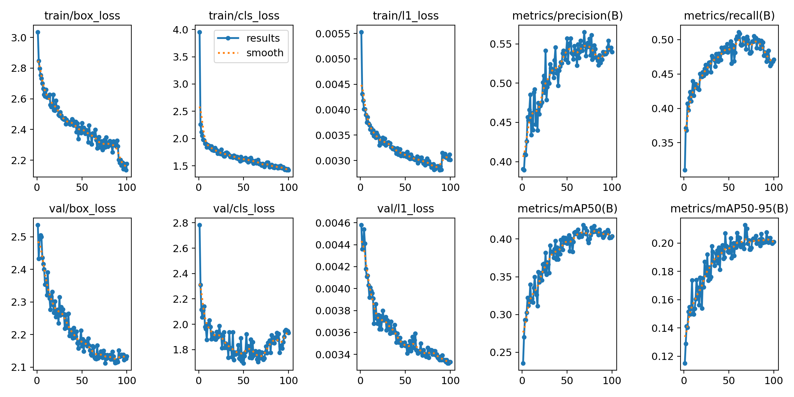
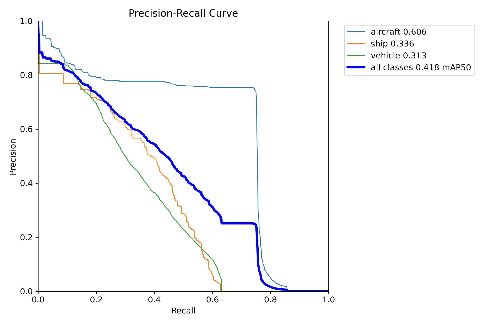
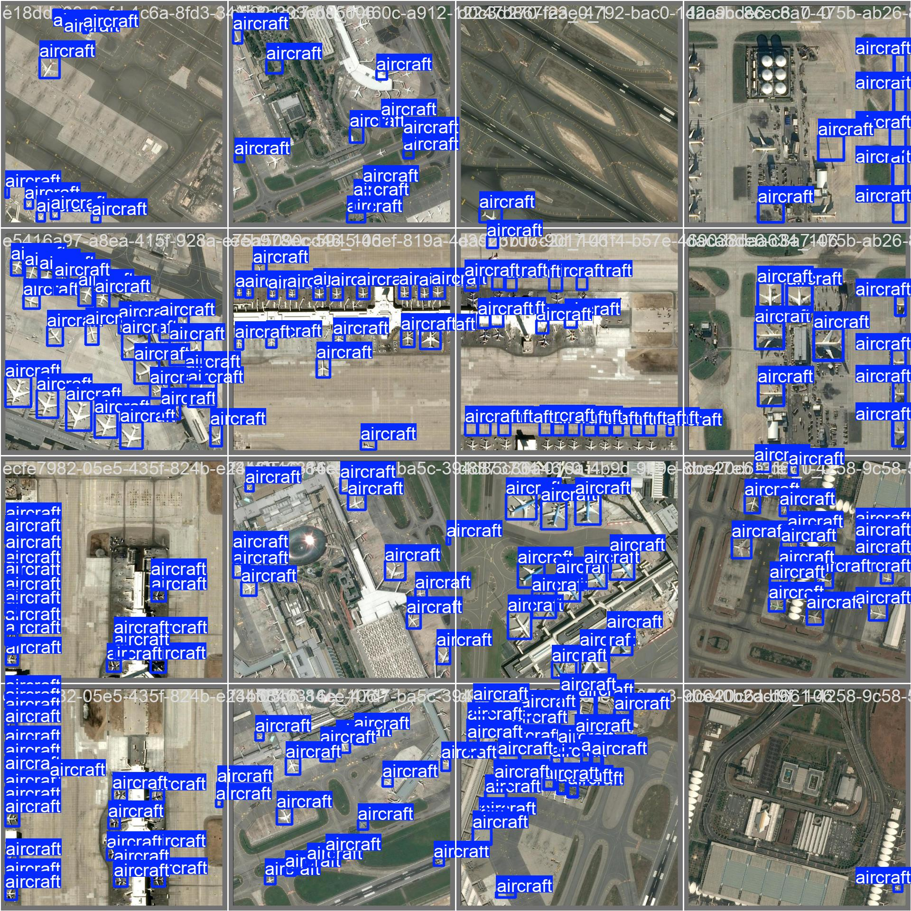
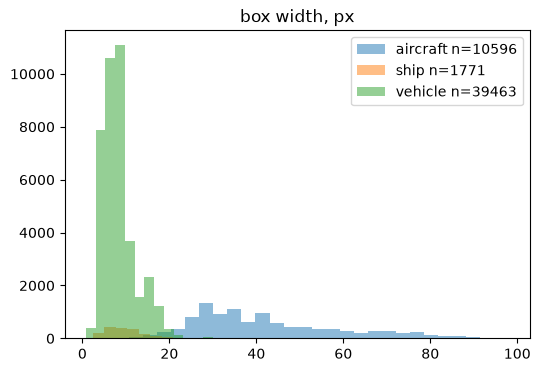

## vanilla yolo26n и анализ ошибок

Было запущено обучение yolo26n на базовом конфиге `configs/yolo26n.yaml`. Метрики прогона на тесте следующие (из output kaggle):

```
mAP50: 0.5532
metrics/precision(B): 0.6549
metrics/recall(B): 0.5785
metrics/mAP50(B): 0.5532
metrics/mAP50-95(B): 0.2952
fitness: 0.2952
mAP50 aircraft: 0.9091
mAP50 ship: 0.3573
mAP50 vehicle: 0.3931
```








уже из этих залогированных на kaggle иллюстраций и графиков видно:

1. в датасете есть неточности в разметке. Последние 2 картинки -- фиксированный батч валидации, слева `gt`, справа `pred`. 1 строка 4 столбец -- лейблы и картинка инвертированы по горизонтальной оси. 2 строка 3 столбец -- лейблы сдвинуты вверх относительно картинки. То же самое на самом деле есть в трейне.
2. на классах с мелкими объектами (vehicle и ship) мтрики заметно хуже, чем на aircraft. это хорошо видно на графике PR-кривой. с ростом recall на классе aircraft recall падает достаточно плавно. А на остальных 2 классах -- почти прямая линия.


дальше провел анализ ошибок. он считается на валидации, берутся боксы с порогом уверенности 0.25.

Для каждого класса отдельно предсказания этого класса сортируются по score и по очереди цепляются к ещё свободному gt того же класса, если IoU >= 0.5. Чужой класс не считается совпадением.

Предсказание, которому не достался gt, -- идет в fp. Gt, до которого никто не дотянулся, идет в fn.
Визуализации представлены в `notebooks/errors.ipynb`.
1. класс `aircraft`. FP и FN идут скорее из за ошибок в разметке.
2. класс `ship`. Опять же, в основном ошибки которые я увидел на валидации -- это ошибки в разметке. Иногда особенно мелкие и стояшие на месте суда (без следа позади на воде) модель не замечает и они идут в FN. В целом с локализацией тут сложнее, так как модель иногда захватывает вместе с судном след на воде позади и получается FP.
3. класс `vehicle`. Очень много объектов. есть как ошибки в разметке, опять же (в основном из визуализаций на валидации -- не все автомобили обведены боксами). Еще в FP идут разные прямоугольные будки, похожие на грузовики. FN -- маленькие авто, модель что-то да пропускает.

Там также видно неточность разметки (не только на классе aircraft, нои на ship), а еще, что объекты ship и vehicle -- очень малы в сравнении с самолетами. В целом это видно было еще на этапе eda, ниже гистограмма с распределениями ширины боксов по классам:



То, что объекты классов ship и vehicle так малы может очень негативно влиять на их детекцию. В yolo объекты раскладываются по уровням голов по размеру, шаг 8 пикселей, то есть при медиане у машин и судов порядка 10 пикселей -- это почти предел. А для мелкого объекта сдвиг в несколько пикселей уже сильно ломает метрику IoU. Дисбалланс классов при этом вторичен. машин в 3 раза больше чем самолетов, но самолет -- лучший по метрикам после детекции.

Самый первый шаг, который хочется предпринять для улучшения скора -- увеличить входные картинки с 640 до, например, 960 пикселей. Это должно помочь с мелкими объектами. Добавил лог этого запуска: `yolo26n_960.yaml` и соответствующий ноутбук.
